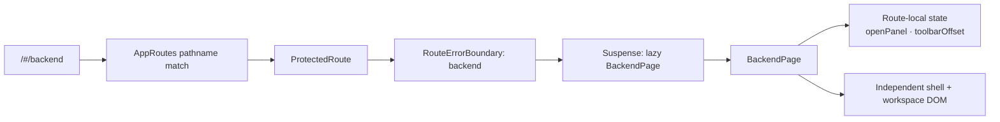
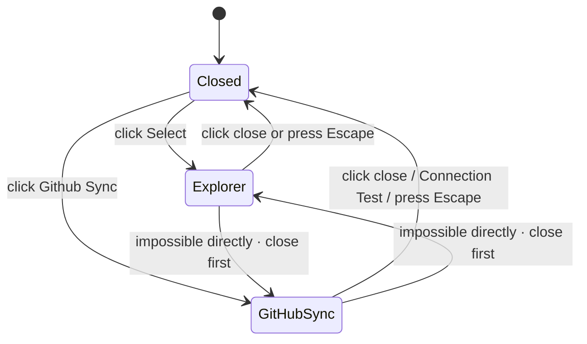
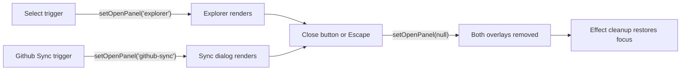

# Backend Workspace Visual Map

This is an as-built map of the protected `/#/backend` route, checked against
[`BackendPage.tsx`](../apps/web/src/pages/BackendPage.tsx) and its styles in
[`styles.css`](../apps/web/src/app/styles.css) on 2026-10-13. It describes the visible structure,
nesting, sizing rules, and current interaction boundaries; it is not a proposal for a future editor.

## At a glance

The diagrams separate **DOM ownership**, **visual containment**, and **interaction flow**. The
dashed arrows identify absolute-positioning containing blocks, not extra grid columns or React
portals.

```mermaid
flowchart TB
    subgraph ROUTE["Protected route · AppRoutes → BackendPage"]
        direction TB
        PAGE_HEADER["Independent sticky header · .backend-header<br/>Back to home → /home · Backend · Deployments (no action)"]
        MAIN["Main area · .backend-main<br/>centered · max width 1280px · padded"]
        subgraph FRAME["DOM: .backend-workspace-container · position: relative"]
            direction TB
            subgraph TWO["DOM: .backend-workspace-panels · equal columns"]
                direction LR
                subgraph LEFT["DOM: workspace panel 1 · position: relative"]
                    direction TB
                    subgraph LAYOUT1["DOM: panel 1 .backend-workspace-panel-layout"]
                        direction TB
                        LGRID[".backend-workspace-panel-layout"]
                        LH["Header grid"]
                        LSYNC["Github Sync button"]
                        MODE["Selection-mode label · div"]
                        SELECT["Select button"]
                        LC["Content region · empty"]
                        LF["Footer region · empty"]
                        LGRID --> LH
                        LGRID --> LC
                        LGRID --> LF
                        LH --> LSYNC
                        LH --> MODE
                        LH --> SELECT
                    end
                    subgraph SYNC["Conditional DOM child: GitHub Sync dialog · z-index 2"]
                        direction TB
                        SYNC_ROOT[".backend-github-sync-panel"]
                        SH["Header · title + close"]
                        SC["Content grid"]
                        OWNER["Owner · readonly"]
                        REPO["Repository · readonly"]
                        BRANCH["Branch · readonly"]
                        PAT["PAT · password input"]
                        RESULTS["Connection Test Results"]
                        SF["Footer · Connection Test + disabled Save & Connect"]
                        SYNC_ROOT --> SH
                        SYNC_ROOT --> SC
                        SC --> OWNER
                        SC --> REPO
                        SC --> BRANCH
                        SC --> PAT
                        SC --> RESULTS
                        SYNC_ROOT --> SF
                    end
                end
                subgraph RIGHT["DOM: workspace panel 2 · position: relative"]
                    direction TB
                    subgraph LAYOUT2["DOM: panel 2 .backend-workspace-panel-layout"]
                        direction TB
                        RGRID[".backend-workspace-panel-layout"]
                        RH["Header grid"]
                        LIVE["Live Preview button"]
                        TITLE["Card Editor heading"]
                        RTS["Real-Time-Sync button"]
                        RC["Content region · decorated canvas"]
                        RF["Footer region · empty"]
                        RGRID --> RH
                        RGRID --> RC
                        RGRID --> RF
                        RH --> LIVE
                        RH --> TITLE
                        RH --> RTS
                        subgraph STACK["DOM child of panel 2 content: .backend-card-editor-stack"]
                            direction TB
                            STACK_ROOT["Stack grid"]
                            SUMMARY["Model Training summary button"]
                            CONNECTOR["Connector element · aria-hidden"]
                            CARD[".backend-card-editor"]
                            STACK_ROOT --> SUMMARY
                            STACK_ROOT --> CONNECTOR
                            STACK_ROOT --> CARD
                            CARD --> BODY["Card content · Tensor Flow / Neural Networks"]
                            CARD --> TOOLBAR["Toolbar · 15 icon buttons"]
                            CARD --> NOTES["Notes-or-commands input"]
                        end
                        RC --> STACK_ROOT
                    end
                end
            end
            subgraph EXPLORER["Conditional DOM child: Select explorer · z-index 2"]
                direction TB
                EXPLORER_CLOSE["Close button"]
                EXPLORER_BODY["Currently empty explorer surface"]
            end
        end
        MAIN --> FRAME
        SELECT ==>|"click / setOpenPanel('explorer')"| EXPLORER
        LSYNC ==>|"click / setOpenPanel('github-sync')"| SYNC
        EXPLORER_CLOSE ==>|"click / Escape"| CLOSED["setOpenPanel(null)"]
        SH ==>|Escape / close button| CLOSED
        SF ==>|"Connection Test closes dialog"| CLOSED
        FRAME -. "absolute containing block · inset -1px" .-> EXPLORER
        LEFT -. "absolute containing block · inset 0" .-> SYNC
    end
```



At runtime, `openPanel` is either `null`, `'explorer'`, or `'github-sync'`; only one overlay can
render at once. The workspace underneath remains mounted. Each overlay covers its positioning
anchor; neither is a new workspace panel.

### Legend: component tree versus layout

| Diagram concept | Meaning in this map |
| --- | --- |
| Indented child / solid arrow | DOM containment: the child is rendered inside its parent. |
| Thick arrow | Interaction flow: an event changes local state or closes an overlay. |
| Dashed arrow | CSS containing-block relationship for absolute positioning; it is not DOM nesting. |
| `grid` / `flex` tracks | Space allocation inside a parent; tracks do not create DOM elements. |
| `::before` / `::after` | CSS-painted decoration, not a React component or interactive panel. |
| Overlay | Conditionally rendered DOM child at its declared parent, painted above its positioning anchor. |

The route boundary is also layered: `AppRoutes` selects `/#/backend`, wraps `BackendPage` in
`ProtectedRoute` and a route error boundary, then lazy-loads the page. `BackendPage` itself renders
its own shell and header; it does not use the general Home app shell or `SiteHeader`.

### Route entry and component ownership



The route guard owns authentication access; `BackendPage` owns only local overlay visibility,
toolbar translation, and focus/drag refs. The workspace does not fetch repository records or read
authentication state.

## Panel construction

### Route shell and workspace frame

The route shell is a full-viewport-height column (`min-height: 100dvh`). It renders an independent
sticky header followed by a flexible main area. The header has a 56px minimum height and a centered,
max-1280px inner grid: left navigation, centered Backend heading, right actions. The main area is
also capped at 1280px, centered, and padded `24px 16px` on desktop.

Inside the main area, `.backend-workspace-container` is the positioned outer frame: it has a 1px
border, 6px radius, and 4px inset. That positioned frame is the containing block for the Select
explorer.

`.backend-workspace-panels` is a two-column CSS grid with equal flexible columns and a 4px gap.
At viewport widths up to 760px, it becomes a single column with the two panels stacked.

On desktop, global `border-box` sizing makes the width calculation:

```text
main inner width = min(viewport width, 1280px) - 16px left padding - 16px right padding
workspace grid width = main inner width - 2px frame border - 8px frame inset
each panel width = (workspace grid width - 4px column gap) / 2
```

For a viewport at least 1280px wide, the panel tracks are therefore each 617px wide
(`(1280 - 32 - 2 - 8 - 4) / 2`). Below the 760px breakpoint this two-column equation no longer
applies because the panels switch to stacked rows.

### Box and dimension register

| Element | Parent / containing block | Width or track | Height or tracks | Border / radius |
| --- | --- | --- | --- | --- |
| Backend header | `.backend-shell` | Full viewport width | 56px minimum | Bottom divider |
| Header inner | Header | `min(100%, 1280px)` | 56px minimum | None |
| Main area | `.backend-shell` | `min(100%, 1280px)` | Flexible remainder | None |
| Workspace frame | Main content box | Fills main grid cell | Fills main grid cell | 1px / 6px |
| Panel grid | Workspace frame content box | Two equal `minmax(0, 1fr)` columns | Fills frame | None |
| Each workspace panel | One panel-grid track | Equal share less gap | Fills panel-grid row | 1px / 4px |
| Panel layout | Workspace panel inside | Fills panel inside | Header/content/footer grid | None |
| Header/content/footer cells | Panel layout tracks | Fills row | 41px / flexible / 41px | 1px / 4px |
| Card stack | Right content cell | `min(100% - 32px, 440px)` | `min(445px, 100% - 32px)` | None |
| Card preview | Card stack final row | Fills stack width | Fills remaining row | 1px / 6px |

The register separates CSS track sizes from element content sizes: panel layout padding and gaps
consume space inside the panel; each child cell's own border is already included in that cell's
track size because the app applies `box-sizing: border-box` globally.

### Shared workspace panel frame

Each `.backend-workspace-panel` is a bordered, 4px-radius panel. Its child
`.backend-workspace-panel-layout` uses a three-row grid:

| Row | Desktop sizing | Contents |
| --- | --- | --- |
| Header | 41px | Panel-specific controls/title |
| Content | `minmax(0, 1fr)` | Flexible work surface |
| Footer | 41px | Empty in the current scaffold |

The layout has a 4px inset and 4px gaps between rows. Header, content, and footer each have their
own 1px border and 4px radius. The 41px row height includes the region's border and padding; it is
not 41px of inner content space.

```text
Workspace panel (position: relative; border 1px; radius 4px)
└── .backend-workspace-panel-layout (height: 100%; grid; padding: 4px)
    ├── Header row: 41px ── 4px gap
    ├── Content row: minmax(0, 1fr) ── 4px gap
    └── Footer row: 41px
```

The sizing chain matters:

1. `.backend-workspace-panels` gives the two panel tracks equal shares of the available width
   (`repeat(2, minmax(0, 1fr))`) with a 4px inter-panel gap.
2. Each panel contains a full-height child grid. That grid reserves 41px / flexible / 41px for
   header, content, and footer, then applies 4px inner padding and 4px row gaps.
3. Each row's header/content/footer region draws its own 1px border and 4px radius. With global
   `border-box` sizing, row and control heights include their borders.
4. Workspace buttons inherit the shared `.action-button` border/surface and 42px minimum height,
   then `.backend-header-button` lowers their minimum to 33px and sets a 4px radius.
5. The right header has 4px padding on every side. The left spread header overrides only vertical
   padding to 3px; horizontally it retains 4px. This leaves 33px between its top/bottom borders
   for the 33px-minimum-height controls, without changing the shared 41px header row.

The row is not enlarged to 51px. Select uses the same 33px-minimum-height workspace button styling
as Github Sync, Live Preview, and Real-Time-Sync; its `backend-select-button` class is only a
marker and currently has no sizing rule.

The panel's outer box and the panel layout are separate sizing layers: the panel supplies the
positioning context and 1px frame border; the child layout fills its inside and owns the 4px inset,
row tracks, and gaps. The header/content/footer region is nested one level further and draws its
own border. This is why the controls must be compared to the inner header region, not the outer
panel border.

### Workspace panel 1: selection and sync

The header uses a spread three-column grid:

1. **Github Sync** button, aligned left. It opens the GitHub Sync overlay.
2. **Select Page, Sub Page or Card** label, centered in the flexible middle column. This is a
   bordered `div`, not a button.
3. **Select** button, aligned right. It opens the Select explorer.

At widths up to 560px, the compact responsive rule returns the header to 4px padding and reduces
button padding and font size. The base workspace content and footer are empty.

The Select explorer is positioned absolutely against `.backend-workspace-container`, so it covers
both side-by-side workspace panels. `inset: -1px` extends it over the outer frame border; it has
`z-index: 2`, `overflow: auto`, a 1px border, 6px radius, 4px inset, and a 41px close button at
top/right 4px. The rest of the overlay is empty: there is no page-selection list yet.

The GitHub Sync dialog is a separate absolute overlay inside workspace panel 1, with `inset: 0`;
workspace panel 2 is outside its bounds and remains unaffected. The overlay has its own
`z-index: 2`, border, 4px radius, and `overflow: hidden`. Its Header / Content / Footer rows are
`40px / minmax(0, 1fr) / 44px`, with 4px gaps and inset:

- **Header:** title and close button.
- **Content:** read-only owner, repository, and branch inputs; a password-type PAT input; and a
  Connection Test Results card. The field rows use 41px-high inputs. The result card fills the
  remaining row space, and the content area clips overflow rather than scrolling.
- **Footer:** Connection Test and disabled Save & Connect buttons.

Its content grid is specifically `repeat(4, auto) minmax(120px, 1fr)`: the four field groups each
take their intrinsic label/input height, and the final results card occupies the remaining
available row while remaining at least 120px tall. A 12px gap separates every content child; the
content box has 12px padding and clips excess content (`overflow: hidden`). Each field label is a
grid with a 5px label-to-input gap. The inputs fill the available width and are 41px high.

This is currently a visual scaffold, not a working connection flow. The PAT field is not wired to
authentication or persistence. The Connection Test footer button currently dismisses the dialog;
it does not test a connection. Save & Connect is disabled.

### Workspace panel 2: preview and card-editor scaffold

The header uses three columns for the Live Preview button, centered Card Editor title, and
Real-Time-Sync button. It uses 4px padding at desktop, while the left spread header has its own
3px vertical-padding override. Its two buttons have no handlers.
The center content region has the `.backend-workspace-panel-content--home-background` treatment
and clips its decorative background layers.

Inside the content region, `.backend-card-editor-stack` is centered and capped at 440px wide. At
desktop it is capped at 445px high, with rows for a 41px summary button, a 64px connector, and the
remaining card-editor space. At widths up to 560px, the stack uses narrower outer insets, a 429px
height cap, and a 48px connector.

The card preview is another bordered panel with a 6px radius and 4px inset. Its inner grid is
composed of:

```text
.backend-card-editor · grid; padding 4px; gap 4px
├── Flexible content row · minmax(0, 1fr)
│   └── .backend-card-editor-content · grid; padding 4px; gap 4px
│       ├── Card heading · minimum 45px
│       │   ├── Tensor Flow title + icon
│       │   └── Neural Networks category
│       └── Remaining content space · currently empty
├── Toolbar row · 33px
│   └── clipped viewport → translated flex track → 15 × 24px icon buttons
└── Notes input row · 33px
```

The 15 toolbar action labels, in render order, are: Preview card, Card files, Video preview,
Card layout, Terminal, Card workflow, Bookmark card, Duplicate card, Share card, Card source,
Print card, Card settings, Export card, Validate card, and Card document. They currently have
accessible labels and icons but no feature handlers. The notes field is a plain text input; it is
not connected to save or command behavior.

The workspace panel's footer is empty.

### Header track maps

```text
Panel 1 header · .backend-workspace-panel-header--spread
grid columns: auto | minmax(0, 1fr) | auto
┌────────────────────┬──────────────────────────────┬────────────────────┐
│ Github Sync        │ Select Page, Sub Page or Card│ Select             │
│ first child / start│ flexible middle              │ last child / end   │
└────────────────────┴──────────────────────────────┴────────────────────┘

Panel 2 header · .backend-workspace-panel-header
grid columns: minmax(0, 1fr) | auto | minmax(0, 1fr)
┌────────────────────┬────────────────────┬────────────────────┐
│ Live Preview       │ Card Editor        │ Real-Time-Sync     │
│ first child / start│ centered title     │ last child / end   │
└────────────────────┴────────────────────┴────────────────────┘
```

Both headers use 4px gaps. The panel 1 spread header has 3px vertical padding at desktop to fit
33px controls into the bordered 41px header cell. The panel 2 header keeps the base 4px padding.
These header-internal grids do not change the surrounding panel row dimensions.

## State, event, and focus map

### Overlay state machine



The event chain is:



`openPanel` is the single owner for both overlay visibility and the `aria-expanded` value on each
trigger. On open, the effect moves focus to that overlay's close button. On close, cleanup restores
focus to the previously active element, or falls back to the corresponding trigger when no usable
previous element exists.

### Inert regions while an overlay is open

| State | Inert | Still outside the overlay |
| --- | --- | --- |
| Closed | Nothing | Entire route |
| Select explorer open | Independent route header and both workspace panels (`.backend-workspace-panels`) | Explorer overlay |
| GitHub Sync open | Only panel 1's `.backend-workspace-panel-layout` | Route header, panel 2, and GitHub Sync overlay |

The Select explorer declares `role="dialog"` and `aria-modal="true"` and handles Tab by preventing
the default and refocusing its only control, the close button. GitHub Sync declares `role="dialog"`
but does not set `aria-modal` or add an explicit Tab handler. Both overlays close on Escape. Neither
currently implements backdrop-click dismissal.

### Button behavior inventory

| Control | Current behavior |
| --- | --- |
| Back to home | Navigates to `APP_ROUTES.home`. |
| Deployments | Button with no click handler. |
| Github Sync | Sets `openPanel` to `'github-sync'`. |
| Select | Sets `openPanel` to `'explorer'`. |
| Connection Test | Closes GitHub Sync; does not perform a test. |
| Save & Connect | Disabled. |
| Live Preview / Real-Time-Sync | Buttons with no click handlers. |
| Model Training summary | Button with no click handler. |
| Card toolbar actions | 15 buttons with labels/icons/titles, but no action handlers. |
| Notes-or-commands field | Plain text input; no save or command handler. |

The toolbar's horizontal dragging is the only non-overlay interaction with component state:
pointer-down records pointer ID, X origin, and current offset, then captures the pointer; pointer
movement clamps the translated track between zero and the maximum overflow; pointer-up releases
capture. Movement greater than 3px marks the gesture as a drag and suppresses the resulting click.
Pointer cancellation clears the drag state.

```text
pointerdown(button 0)
  → store { pointerId, startX, startOffset, moved: false }
  → capture pointer
pointermove(same pointer)
  → delta = currentX - startX
  → moved = true when abs(delta) > 3px
  → maxOffset = max(0, track.scrollWidth - viewport.clientWidth)
  → toolbarOffset = clamp(startOffset + delta, -maxOffset, 0)
pointerup(same pointer)
  → suppress next click if moved
  → clear drag record and release pointer capture
pointercancel(same pointer)
  → clear drag record and click-suppression flag
```

The drag ref holds the in-progress pointer gesture; `toolbarOffset` is React state because it
drives the track's inline `translateX(...)`. Click suppression is a separate ref so a drag ending
over a toolbar button does not accidentally invoke a click.

## Style and containment layers

| Layer | Positioned against | Coverage | Paint/clip behavior |
| --- | --- | --- | --- |
| Select explorer (`z-index: 2`) | `.backend-workspace-container` | Whole outer workspace, both columns | `inset: -1px`; own scroll container and frame |
| GitHub Sync (`z-index: 2`) | Panel 1 (`position: relative`) | Left panel only | `inset: 0`; own grid; clips overflow |
| Workspace columns | Normal grid flow | Half-width sibling tracks on desktop | Stack at 760px and below |
| Card-editor stack | Centered by panel 2 content grid | Inside right content region | Capped width/height |
| Decorative backgrounds | Pseudo-elements of right content | Right content only | Negative z-index within isolated, clipped region |

The card editor content region uses `isolation: isolate` and `overflow: hidden`; its dot-grid and
glow are pseudo-elements behind content, not extra panel nodes. The connector between the summary
button and card is also CSS-painted with pseudo-elements and is marked `aria-hidden`. These
decorations do not change the DOM panel hierarchy.

The two overlays share `z-index: 2`, but their anchors are different and the state is mutually
exclusive. They do not overlap each other in a normal render: selecting one first closes the other
because `openPanel` can contain only one string value.

## Responsive behavior

- **Above 760px:** workspace panels are side by side.
- **At or below 760px:** workspace panels stack vertically.
- **At or below 560px:** the shared panel layout uses an automatic-height header row and a 33px
  footer row. The spread left header keeps its three columns but uses compact control padding and
  text; the selection label can wrap. The right panel header can wrap its title onto a second row.
  The card-editor stack and connector also become shorter.

These are the current CSS breakpoints and rules, not guarantees about a fixed viewport screenshot.

## Reading the code

| Concern | Source |
| --- | --- |
| Route markup, state, panel nesting, overlay anchors, and current handlers | [`BackendPage.tsx`](../apps/web/src/pages/BackendPage.tsx) |
| Workspace, panel, overlay, card-stack, and responsive geometry | [`styles.css`](../apps/web/src/app/styles.css) |
| Backend route protection and route-level ownership | [`AppRoutes.tsx`](../apps/web/src/app/AppRoutes.tsx) |
| Current verified product capability and limits | [`PRODUCT_BRIEF.md`](./PRODUCT_BRIEF.md) |

The focused tests in [`BackendPage.test.tsx`](../apps/web/src/pages/BackendPage.test.tsx) cover the
route scaffold and GitHub Sync overlay ownership, content, and focus behavior. Use the current
component and styles as the source for exact visual geometry and responsive rules.
